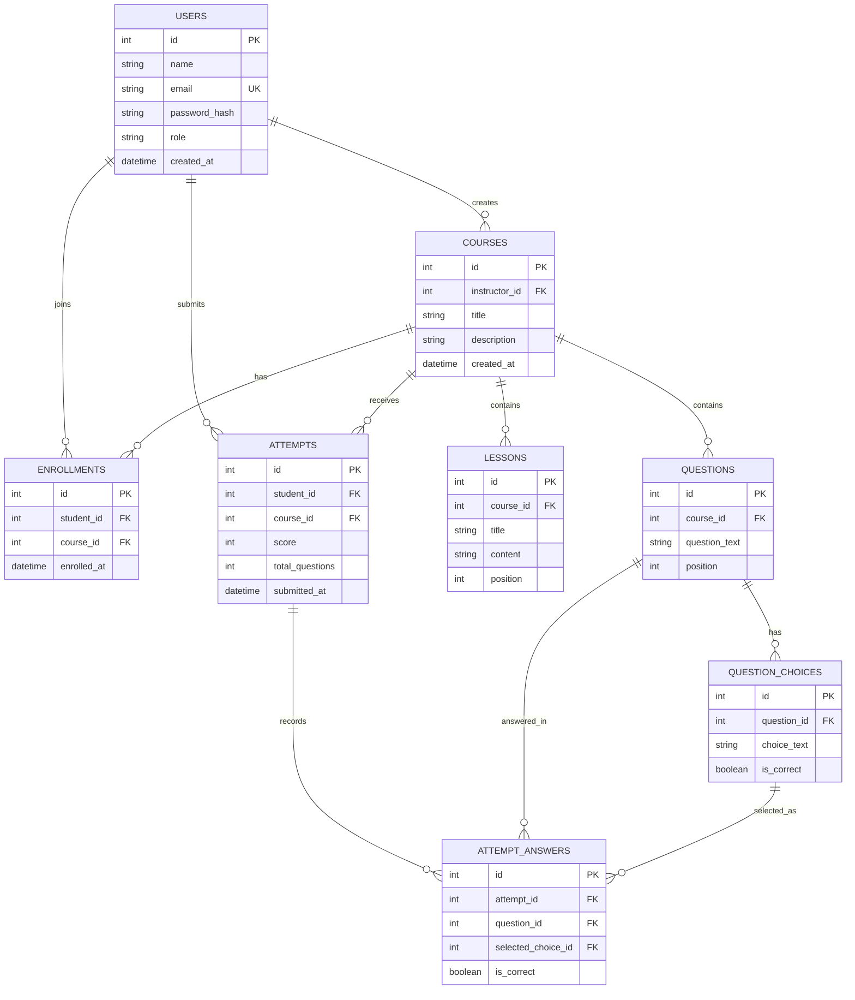

# LearnTrack — Entity Relationship Diagram

This diagram reflects the database schema in `src/database/schema.sql`.

## Entity relationship diagram

## Relationship explanation

- One instructor can create multiple courses.
- Students can enroll in multiple courses, and each course can have multiple enrolled students.
- One course can contain multiple lessons and quiz questions.
- One question can have multiple answer choices.
- One student can submit multiple attempts.
- Each attempt belongs to one student and one course.
- Each attempt can contain multiple submitted answers.
- Each answer references the question and selected choice.

## Database constraints and application rules

- User email addresses are unique.
- User roles are restricted to `instructor` and `student`.
- A student can enroll only once in a given course.
- Each question can have only one correct choice, enforced by a partial unique index.
- A question can be answered only once per attempt.
- Course deletion cascades to its lessons, questions, and enrollments.
- Question deletion cascades to its answer choices.
- Attempt-answer rows cascade when their parent attempt is deleted.
- The application prevents changes to questions referenced by saved answers and prevents deleting a quiz or course while attempts exist.

## Implementation note

The database enforces core relationships and uniqueness constraints. The Express routes enforce authentication, role permissions, course ownership, enrollment requirements, quiz validation, and server-side score calculation.
